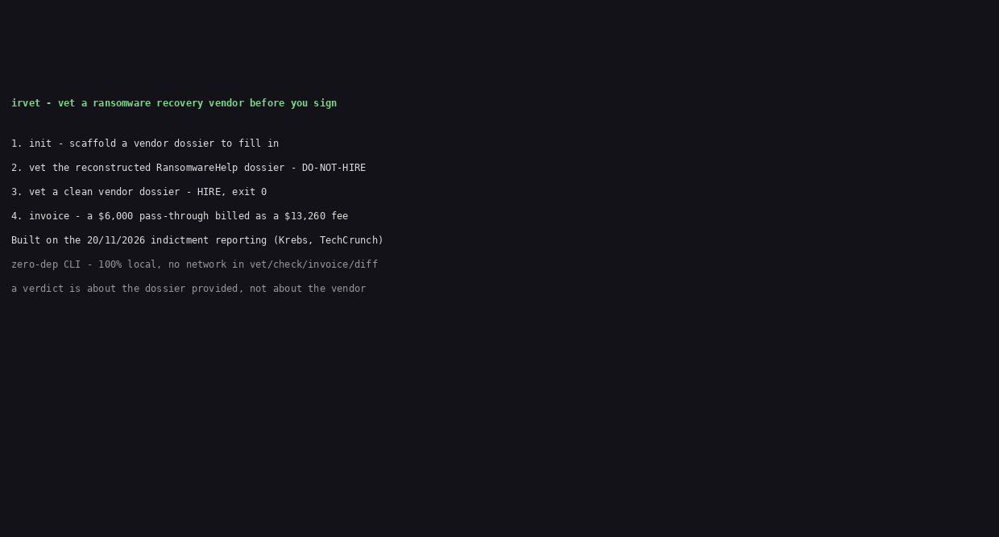

# irvet

**Vet a ransomware recovery vendor before you sign.**
irvet turns pre-engagement vendor vetting into an evidence check you can run: dossier in, verdict out (HIRE, CONDITIONAL, DO-NOT-HIRE, NEEDS-EVIDENCE), with an exit code for a procurement gate.



On 20/11/2026, Krebs on Security reported that the CTO of
RansomwareHelp had been indicted for wire fraud: the firm allegedly
promised "100% recovery" with "proprietary cryptography" and "never
pay ransom", while secretly paying the ransom and billing victims far
more. The alleged scheme ran for about six years. irvet exists so the
next buyer checks the vendor's claims against evidence *before*
signing, not after the money moves.

## What it does

`irvet vet vendor.json` audits a dossier against 8 rules (V1-V8):

| Rule | What it checks | Severity |
| ---- | -------------- | -------- |
| V1 METHOD-IN-WRITING | recovery method written down, per strain | HIGH |
| V2 NO-PAYMENT-CLAUSE | contract states the ransom-payment position | HIGH |
| V3 PAYMENT-TRAIL-AUDIT | audit right + itemised invoice | HIGH |
| V4 RANSOM-NOTE-KEPT | ransom note stays with the victim | HIGH |
| V5 SUPERVISED-ACCESS | remote access supervised and scoped | MEDIUM |
| V6 REFERENCES-VERIFIABLE | at least one reference you can check | MEDIUM |
| V7 NO-ABSOLUTE-GUARANTEE | no "100% recovery" style claims | MEDIUM |
| V8 OFAC-SCREENING | sanctions-screening statement | MEDIUM |

Verdict: any HIGH rule fails -> DO-NOT-HIRE; only MEDIUM rules fail
-> CONDITIONAL; required evidence missing -> NEEDS-EVIDENCE; all pass
-> HIRE. A verdict is about the DOSSIER provided, not about the
vendor. HIRE means "no red flags in the dossier provided - this does
not prove the vendor is honest".

`irvet invoice` reconciles an invoice against the contract: it flags
pass-through costs billed as service fees, "decryption fees" charged
while the contract says no ransom payment, lines not in the contract,
and totals that do not add up.

## Install

Install from source for now (the npm package is not published yet):

```sh
git clone https://github.com/techdevfun/irvet.git
cd irvet
npm install
npm run build
node dist/cli.js vet examples/clean-vendor/vendor.json
```

## Usage

```sh
irvet init [dir]                              # scaffold vendor.json + irvet.config.json
irvet vet <dossier> [--json]                  # full audit (exit 0/1/2)
irvet check <dossier> [--json]                # CI gate: 1-line verdict + exit code
irvet invoice <invoice.json> --contract <contract.json> [--json]
                                              # reconcile invoice vs contract
irvet diff --baseline <baseline.json> <dossier> [--json]
                                              # exit 1 when a rule regresses
irvet explain [rule]                          # how to fix each rule, with the case anchor
irvet explain ransomwarehelp                  # the 20/11/2026 case, with sources
```

Exit codes: 0 HIRE, 1 DO-NOT-HIRE or CONDITIONAL (or a diff
regression), 2 input error or NEEDS-EVIDENCE.

All commands are 100% local and offline. irvet never contacts a
vendor, never runs vendor code, and never asks for a credential,
token, or password. Amounts shown by `irvet invoice` are the user's
own invoice data, supplied to reconcile.

## Example

```sh
$ irvet vet examples/ransomwarehelp-reconstructed/vendor.json
irvet 0.1.0 - vendor vetting (dossier: examples/ransomwarehelp-reconstructed/vendor.json)
vendor: RansomwareHelp (RECONSTRUCTED)
rule  severity  status    detail
V1    HIGH      FAIL      claims a proprietary decryptor for a strain with a public decryptor and does not name the public one
V2    HIGH      FAIL      claims 'never pay' in marketing but the contract has no payment clause
V3    HIGH      FAIL      no audit right; no itemised invoice
V4    HIGH      FAIL      vendor asks for the ransom note to be deleted
V5    MEDIUM    FAIL      vendor requires unsupervised remote access
V6    MEDIUM    PASS      -
V7    MEDIUM    FAIL      absolute claim in marketing material: "100% recovery"
V8    MEDIUM    MISSING   no OFAC screening statement in the dossier
VERDICT: DO-NOT-HIRE
```

```sh
$ irvet check examples/clean-vendor/vendor.json
VERDICT: HIRE (Example Recovery Co)
No red flags in the dossier provided - this does not prove the vendor is honest.
GATE PASSED
```

```sh
$ irvet invoice examples/invoice-markup/invoice.json --contract examples/invoice-markup/contract.json
irvet invoice check (invoice: examples/invoice-markup/invoice.json)
line total: $16,010 | stated total: $16,010 (matches)
findings: 2
  [MARKUP] Decryption fee
    pass-through cost $6,000 billed as a $13,260 service fee (markup $7,260, +121%).
  [NO-PAYMENT-CLAUSE] Decryption fee
    a "Decryption fee" line of $13,260 while the contract states no ransom payment.
FLAGGED: review before paying.
```

## Examples

- `examples/ransomwarehelp-reconstructed/` - **RECONSTRUCTED, not a
  real dossier.** Rebuilt from public indictment reporting (Krebs,
  20/11/2026; TechCrunch, 25/11/2026). DO-NOT-HIRE: V1, V2, V3, V4,
  V5, V7 fail.
- `examples/clean-vendor/` - synthetic vendor that passes every rule.
  HIRE.
- `examples/conditional-vendor/` - same as clean-vendor except the
  marketing promises "100% recovery guaranteed". CONDITIONAL.
- `examples/invoice-markup/` - the sting pattern: a $6,000
  pass-through billed as a $13,260 "decryption fee" plus a $2,750
  diagnostic fee. 2 findings.

## Where rivals beat us

- **Readiness Authority's vetting guide** goes deeper on contract
  language and insurer-panel nuance than irvet's v0.1.0 rule set.
  irvet only checks that a clause exists and states the minimum; it
  does not replace a lawyer reading the contract.
- **TPRM SaaS (UpGuard, SecurityScorecard, OneTrust)** monitors vendors
  continuously and scores them over time. irvet v0.1.0 is a
  point-in-time check; it does not monitor.
- **No More Ransom** holds real decryptors per strain. irvet only
  cross-checks a vendor's CLAIM against the list of strains with a
  public decryptor; it decrypts nothing.
- irvet cannot verify that a vendor actually did what it claims in the
  past. It only finds contradictions, missing evidence, and red flags
  in the dossier in front of it.

## Honest limits

- A verdict is about the dossier provided. A vendor with a thin
  dossier fails even if the vendor is honest; a vendor with a polished
  dossier passes even if it is not. irvet checks evidence, not truth.
- irvet is not legal advice and not a legal-investigation tool. The
  OFAC rule points at the advisory; ask a lawyer for the legal
  position.
- The RansomwareHelp CTO was indicted, which means accused, not
  convicted. irvet never states guilt. Do not use a verdict to accuse
  a vendor in public.
- Facts are as of 27/11/2026. The case may develop; rules V1-V8 do not
  depend on the outcome of the trial.

## The RansomwareHelp case (facts as of 27/11/2026)

Juan Ricardo Palacio Escobar, 52, CTO and co-founder of
RansomwareHelp (ransomwarehelp.com, Florida), was indicted for wire
fraud by a Rhode Island grand jury on 18/11/2026: 3 counts, up to 20
years each. The alleged scheme ran about 10/2020-06/2026. In a June
2026 FBI sting, the FBI posed as both victim and a fake ransomware
group; the fake group asked 0.2 BTC (about $13,000), Palacio
allegedly negotiated it down to about $6,000 in BTC, then billed the
fake victim $16,010 ($2,750 diagnostic + $13,260 decryption fee). In
a 2024 case, the firm quoted $438,880 to a small accounting firm hit
by LockBit, demanded unsupervised remote access via AnyDesk, and
allegedly deleted the ransom note. The same DOJ pattern in 10-11/2026:
MonsterCloud CEO Zohar Pinhasi indicted (allegedly paid about $8
million, billed clients $19 million); Edward Dubrovsky (Cybersteward)
indicted for cyber extortion; Angelo Martino sentenced to 70 months
for passing client negotiation positions to BlackCat/ALPHV.

Sources: Krebs on Security, 20/11/2026; TechCrunch, 25/11/2026;
QUE.com, 23/11/2026; Security Arsenal, 21/11/2026. Verified
27/11/2026.

## Roadmap

- P1: GitHub Action wrapper (vet as a CI step on the procurement repo).
- P2: SARIF output; baseline trend over time; insurer-panel lookup
  helper.
- Not doing: contacting vendors, network scans, legal advice, or
  publishing verdicts (read-only by design).

## Contributing

See [CONTRIBUTING.md](CONTRIBUTING.md). Bug reports should include
the dossier (redacted) and the irvet output.

## License

MIT. See [LICENSE](LICENSE).
